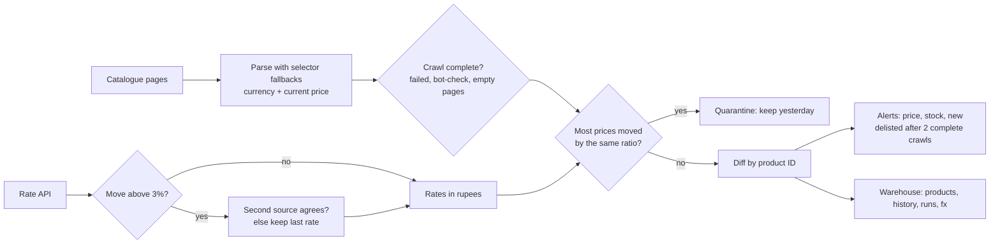

# ShelfWatch


**Competitor price and stock monitoring for Indian online sellers: crawl competitor catalogues every day, convert to rupees, check each crawl before trusting it, and send only real changes.**

A pricing team that watches competitors with a scraper learns the hard way that scrapers fail quietly. A timed-out page makes 20 products look delisted. A bot-check page makes them vanish. A renamed CSS class turns every price into nothing. A site that shows euros to some visitors makes every price look 15% lower. An exchange-rate API that returns paise instead of rupees multiplies the whole catalogue by 100. Each of these lands in the warehouse as fact and in Slack as an alert.

ShelfWatch treats every crawl as evidence to check:

| Check | What it prevents |
|---|---|
| **Crawl completeness**: catalogue total vs products seen, failed and bot-check pages | Products are delisted only after two *complete* crawls miss them; after an incomplete crawl they are marked stale, never gone |
| **Selector fallbacks** per site | A renamed class does not zero the catalogue |
| **Price parsing** that reads the currency and the current price of a sale (`£12.99 £9.99` → £9.99) | Wrong numbers from "Was / Now" prices and mixed currencies |
| **Exchange-rate guard**: a move above 3% in a day needs a second source to agree, otherwise the last accepted rate is kept | One bad API response repricing everything |
| **Mass-change guard**: most prices moving by the same ratio means a currency or unit problem | The run is quarantined; yesterday's data stays |
| **Stable product identity** from the product page (UPC / ISBN / SKU), not the title | A corrected title is a title change, not "one product delisted, one new" |

It started as an Airflow ETL over [books.toscrape.com](https://books.toscrape.com) (scrape, convert GBP to INR, load to PostgreSQL). The original logic is kept in `baseline.py` as the thing to beat.

## Results

`python -m shelfwatch.evaluate` runs both pipelines every day on a simulated competitor catalogue in the books.toscrape.com layout: 1,000+ products, daily price moves, sales shown as "was / now", stock-outs, new and delisted products, title corrections and moving exchange rates. On 30–35% of days the crawl goes wrong. The truth is known, so every day's warehouse and alerts are scored against it. Dev: two catalogues over 40 days. **Held-out**: a different catalogue, different fault rates and three fault types never seen in dev (an unknown page layout, pages served from a stale cache, both rate APIs down), run once.

| dev / held-out | Wrong prices in the warehouse, silent | Real changes alerted within 2 days | False alerts |
|---|---|---|---|
| Original pipeline | 20,375 / 10,739 | 2,426/3,096 (78%) / 1,208/1,548 (78%) | 8,861 / 7,264 |
| **ShelfWatch** | **0 / 29** | **3,091/3,096 (100%) / 1,536/1,548 (99%)** | **0 / 3** |

Wrong prices are counted per product per day (81,574 product-days in dev, 41,215 held-out). "Silent" means nothing marks the number as doubtful; ShelfWatch marked another 6 / 2 as stale.

**Reading it honestly:**
- The original pipeline is not careless code: it does what most scrapers do. Its errors come from trusting every crawl. One timed-out page fails the whole day, a bot-check page "delists" 20 products, a euro day "cuts" every price, sale prices cannot be read, and a corrected title becomes a delisting plus a new product.
- **The held-out misses are real.** Pages served from a stale cache look like a normal crawl with old prices, and nothing in a single crawl can tell; that caused the 29 silent errors and the 3 false alerts. The unknown layout was quarantined correctly (no wrong data), but changes that day were alerted a day late or not at all.
- The simulator is mine, and so are the faults. It shows the checks do what they are built for. A pilot on a client's real competitors is the test that counts.

### How the benchmark kept me honest

| Finding | Fix |
|---|---|
| Correct delisting alerts delayed by a partial crawl were scored as both a miss and a false alert | Score alerts that arrive later than 2 days as "late", not false; report both |
| Changes on the last day of a run could not be confirmed by any system | Those days are not scored, for either pipeline |
| A unit test expected the 6th product to be the one I changed, but new arrivals are listed first | Track the product itself, not its position |

## Who buys it and how it is sold

| | |
|---|---|
| **Buyers** | D2C brands and marketplace sellers (Amazon, Flipkart, own website), online booksellers and importers, category managers at retailers, brands checking that resellers keep to the agreed minimum price (MAP) |
| **Their pain** | Interns copying competitor prices into Excel; scrapers that break without telling anyone; alerts nobody trusts after a few false alarms; prices in pounds, euros and dollars |
| **What they get** | A daily list of competitor price changes, stock-outs, new and delisted products in rupees; where a competitor undercuts them on their own price list; a run log saying how complete each crawl was |
| **Fits in** | Airflow DAG or a cron job; PostgreSQL; REST API for the pricing sheet, ERP or Slack bot; Streamlit desk screen |
| **Responsible crawling** | Respects robots.txt, identifies itself, waits between requests, fetches a product page only once |

**Value example** (an illustration, not a promise): a seller with 2,000 SKUs that matches a competitor's price drop one day sooner on 5% of SKUs a week, at ₹100 of margin or lost sale each, keeps about ₹10,000 a week; and nobody spends an hour a day checking prices by hand.

| Plan (suggested) | For | Price idea |
|---|---|---|
| Starter | 1 competitor site, up to 2,000 products | Monthly fee |
| Growth | Up to 10 sites, undercut alerts, API | Per site per month |
| Brand / MAP | Reseller monitoring across marketplaces | Annual contract, custom site adapters |

**Pilot plan (two weeks):** pick two competitor sites and the seller's price list. Run ShelfWatch daily next to the current process; at the end compare the changes each caught, the false alarms, and the hours spent.

## How it works



## Use it

```bash
pip install -e ".[app]" && streamlit run app.py            # desk screen on a simulated month
pip install -e .
shelfwatch run --max-pages 2                                # today's crawl of books.toscrape.com
shelfwatch alerts --since 2026-01-01 --out alerts.csv
shelfwatch undercut my_prices.csv --margin 0.05             # product_id,my_price_inr
python -m shelfwatch.evaluate                               # the benchmark above
cp .env.example .env && docker compose up -d                # Postgres + Airflow :8080 + API :8000 + screen :8501
```

| Endpoint | What it does |
|---|---|
| `GET /v1/runs` | Run log: status, coverage, issues, exchange rates |
| `GET /v1/alerts?since=&kind=` | Changes |
| `GET /v1/products/{id}/history` | Price and stock history |
| `POST /v1/undercuts` | My prices in rupees → where the competitor is cheaper |

CI runs the tests and the benchmark gate, a month of runs on a real PostgreSQL, both Docker images, and a short informational crawl of the live site.

## Limitations

- One site adapter (books.toscrape.com). A new site needs its selectors and product ID field, usually a few lines; heavily JavaScript-rendered sites need a headless browser.
- A stale cache that serves old prices with no other sign cannot be caught from one crawl (see the held-out result). Comparing against a second fetch or the site's own feed would.
- Matching my products to a competitor's uses a shared identifier (ISBN, UPC, GTIN, SKU map). Fuzzy matching of titles is not included.
- Check each site's terms before monitoring it; robots.txt is respected, terms of service are the client's call.

## Project layout

```
src/shelfwatch/parse.py      site adapters with selector fallbacks, price and currency parsing
src/shelfwatch/crawl.py      crawl with completeness accounting; product pages fetched once
src/shelfwatch/monitor.py    rate guard, run status, mass-change guard, diff and alerts
src/shelfwatch/store.py      SQLite or PostgreSQL
src/shelfwatch/insights.py   undercuts, alerts, history
src/shelfwatch/synth.py      simulated catalogue and rate API with known truth and faults
src/shelfwatch/baseline.py   the original pipeline's logic
src/shelfwatch/evaluate.py   benchmark and CI gate
src/shelfwatch/api.py        FastAPI service
dags/shelfwatch_dag.py       Airflow DAG
app.py                       Streamlit desk screen
```
